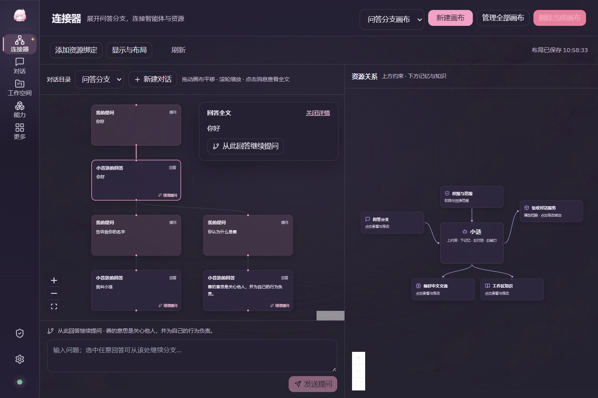
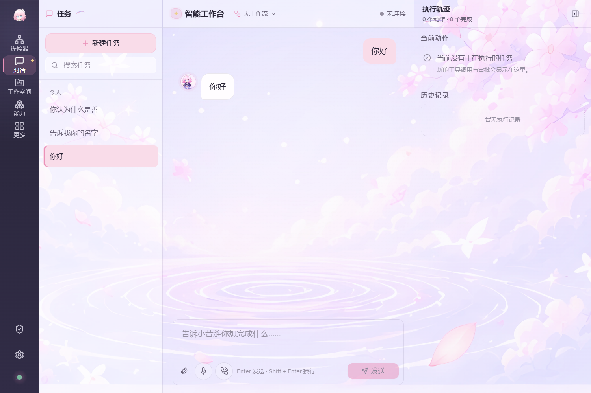
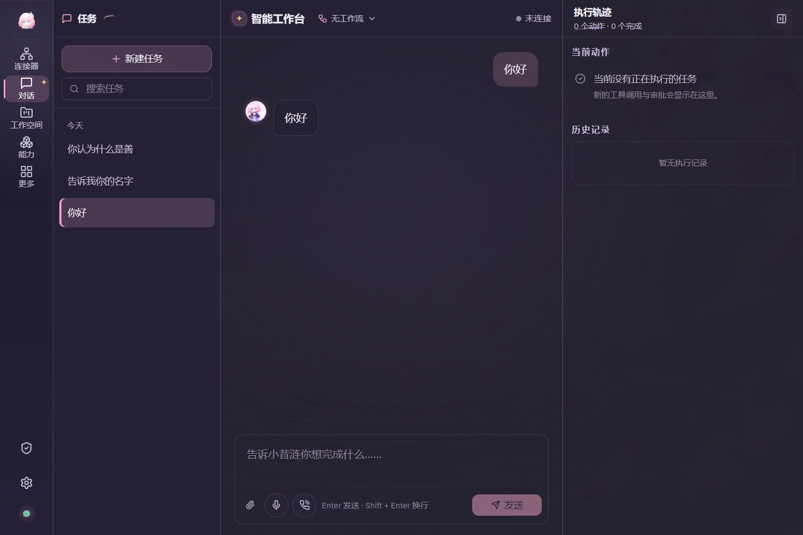
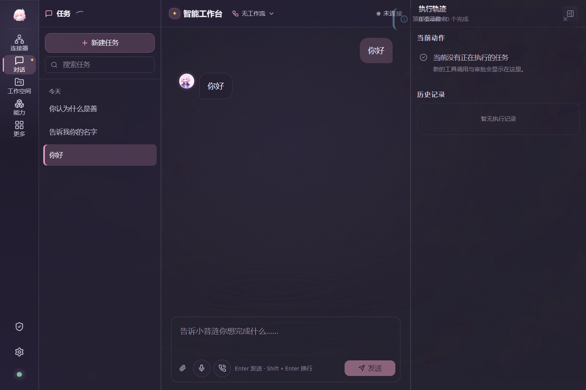
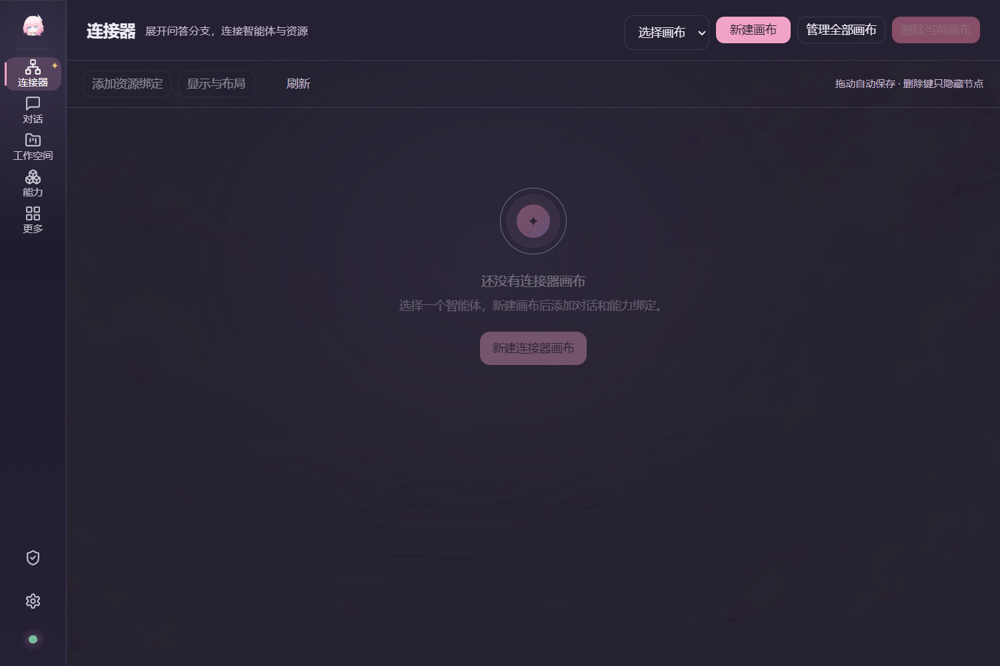
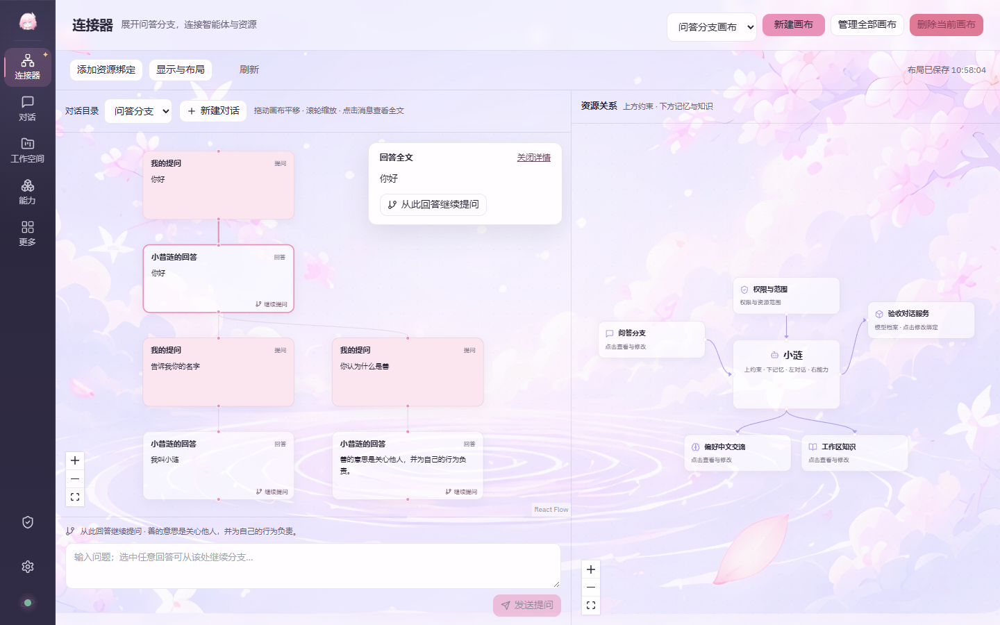
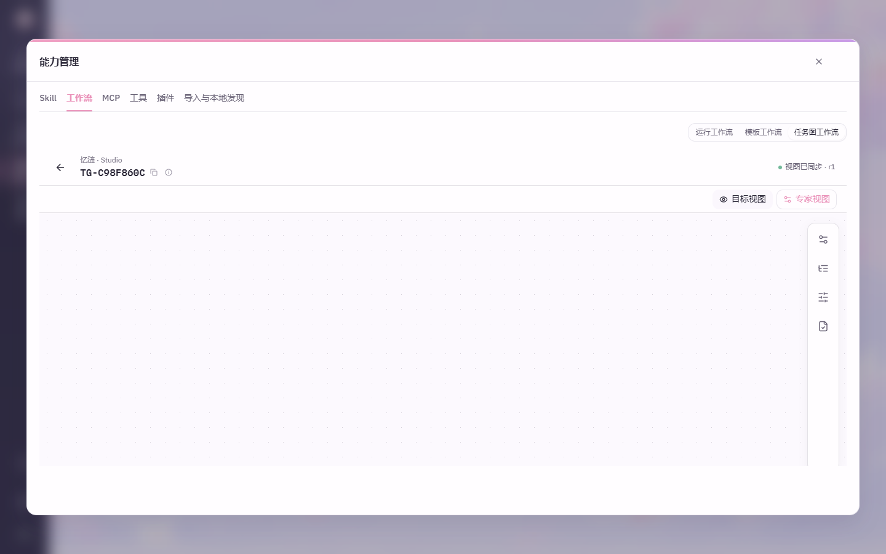
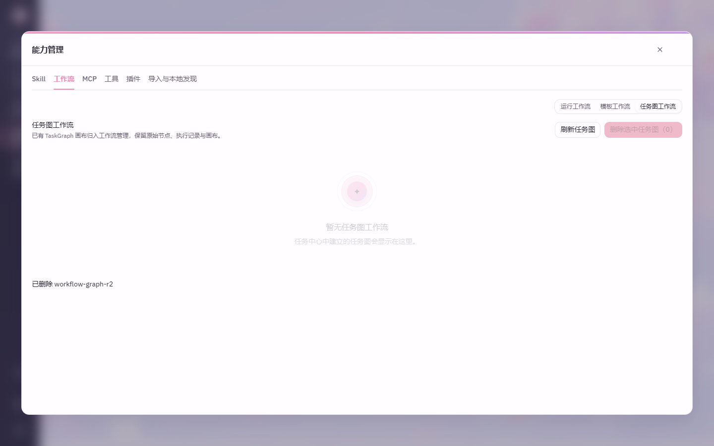

# 第二轮验收：实际运行预览

用户原图作为消息树布局依据。图中消息通过产品消息分支API、普通聊天SSE、持久化与现有模型运行时执行。验证用的HTTP服务按测试问题返回响应；产品代码没有固定回答或替代执行模式。前五张来自实际Tauri WebView2，后三张来自实际后端与Edge。

**实际Tauri：六个问答节点与平行分支、四侧曲线资源关系**

**实际Tauri：浅色透明对话与输入框**

**实际Tauri：深色透明对话与输入框**

**实际Tauri：顶部轻通知**

**实际Tauri：删除最后一张画布后的空状态**

**Edge：六节点消息树**

**工作流中打开原TaskGraph**

**工作流中删除原TaskGraph**

