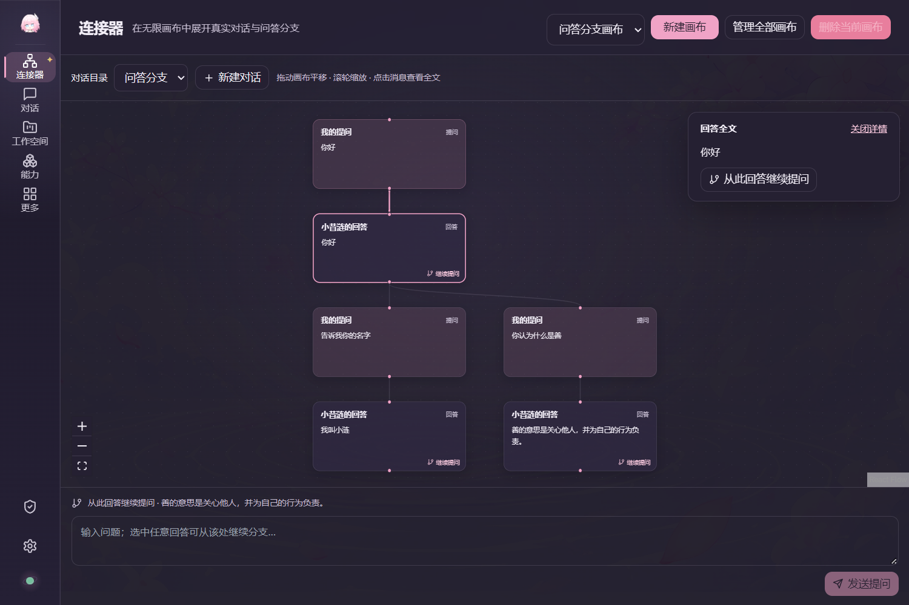
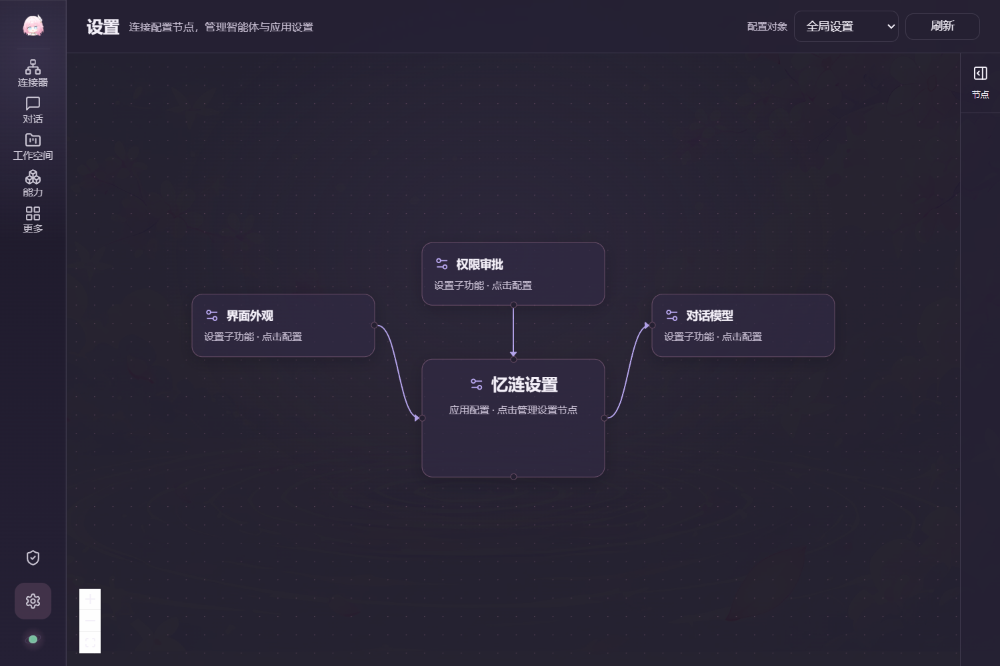
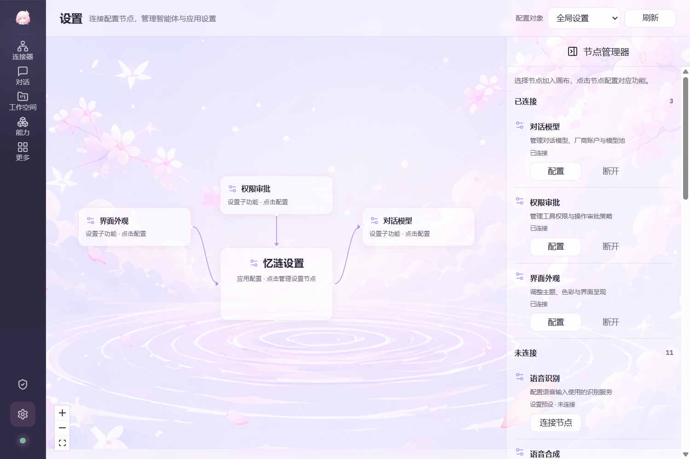
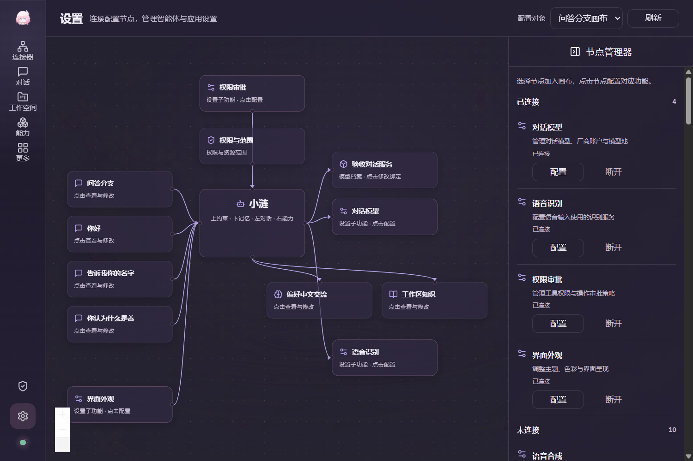
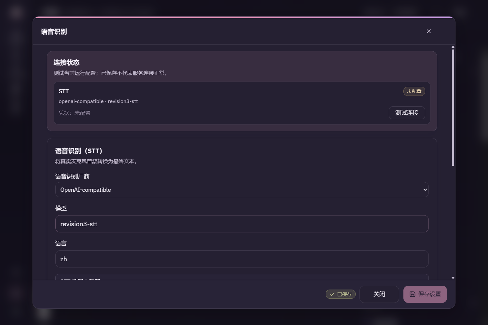
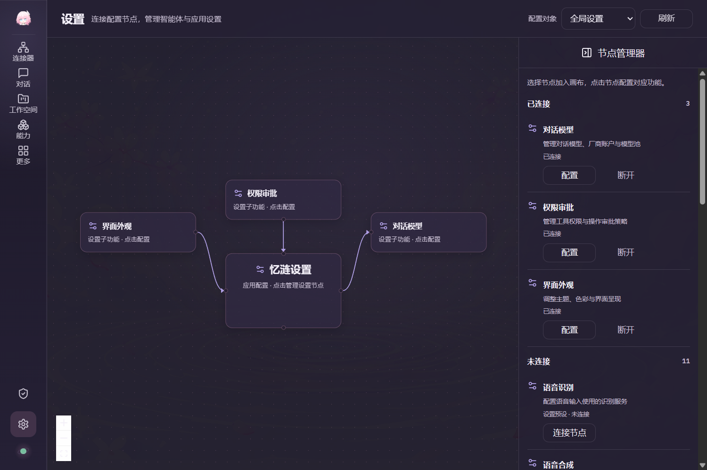
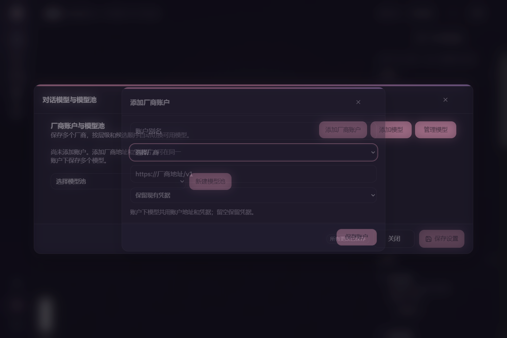
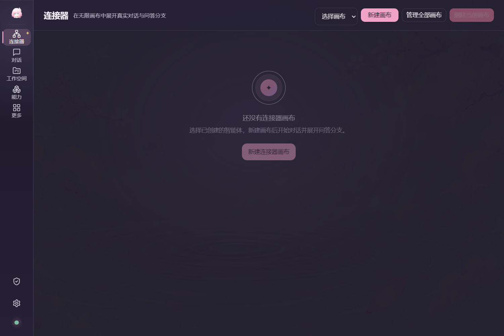
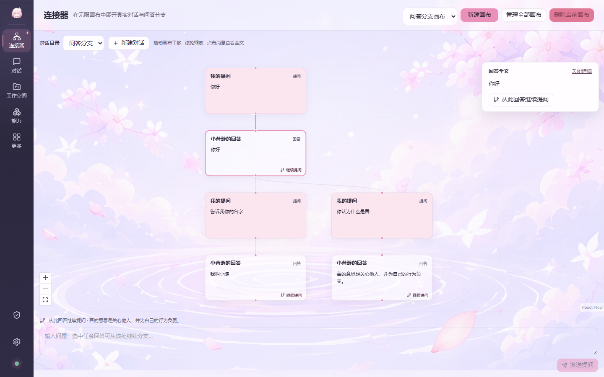

# 第三版实际运行预览

前八张来自实际Tauri WebView2窗口，Windows缩放125%；最后一张为Edge对照。图像未经编辑，源文件与校验值见[清单](manifest.json)。

**连接器：整页问答分支无限画布**

**新版设置：节点管理器默认收起**

**新版设置：展开已连接与未连接节点列表**

**新版设置：原智能体资源关系与新设置节点共同显示**

**语音识别节点：实际配置保存后重开**

**深色主题的节点管理器**

**厂商账户编辑：嵌套弹窗键盘可操作**

**删除最后一张画布后的空状态**

**浅色浏览器对照：整页消息画布**

