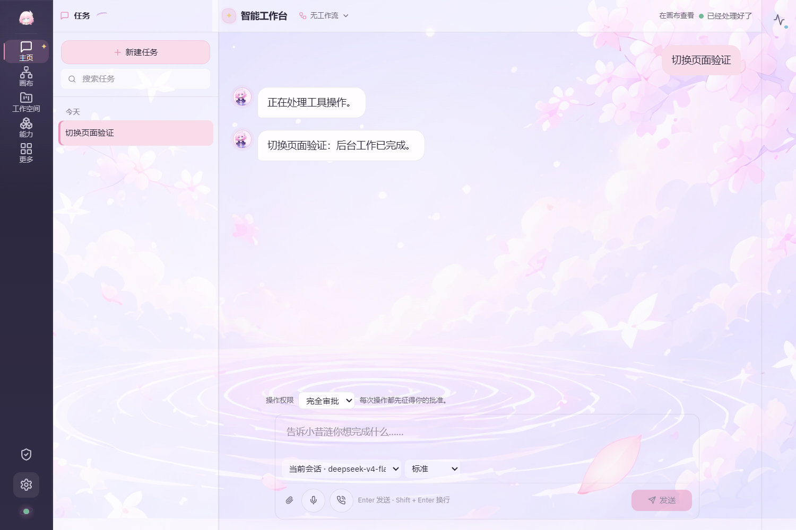
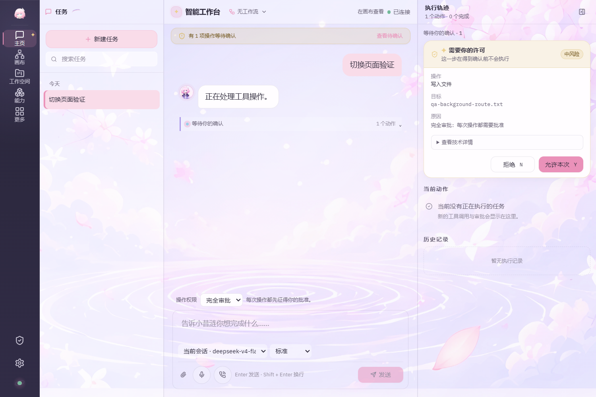
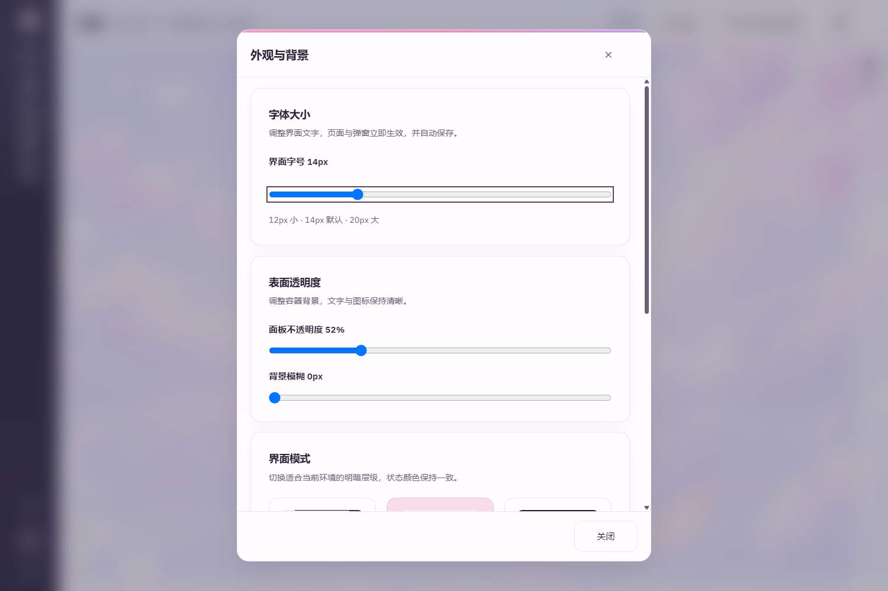
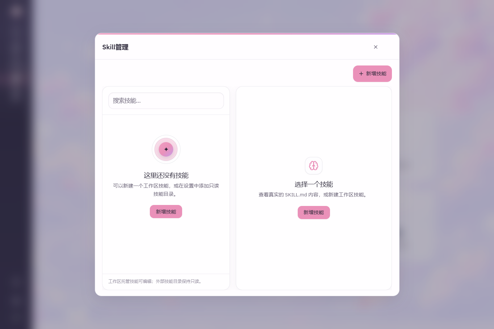
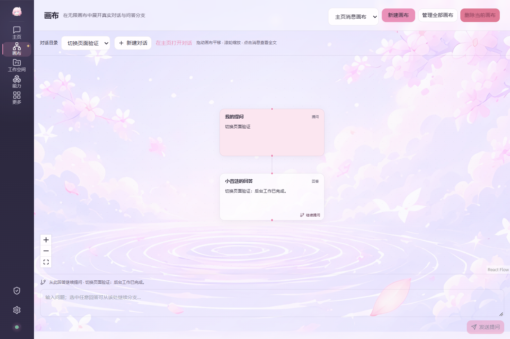
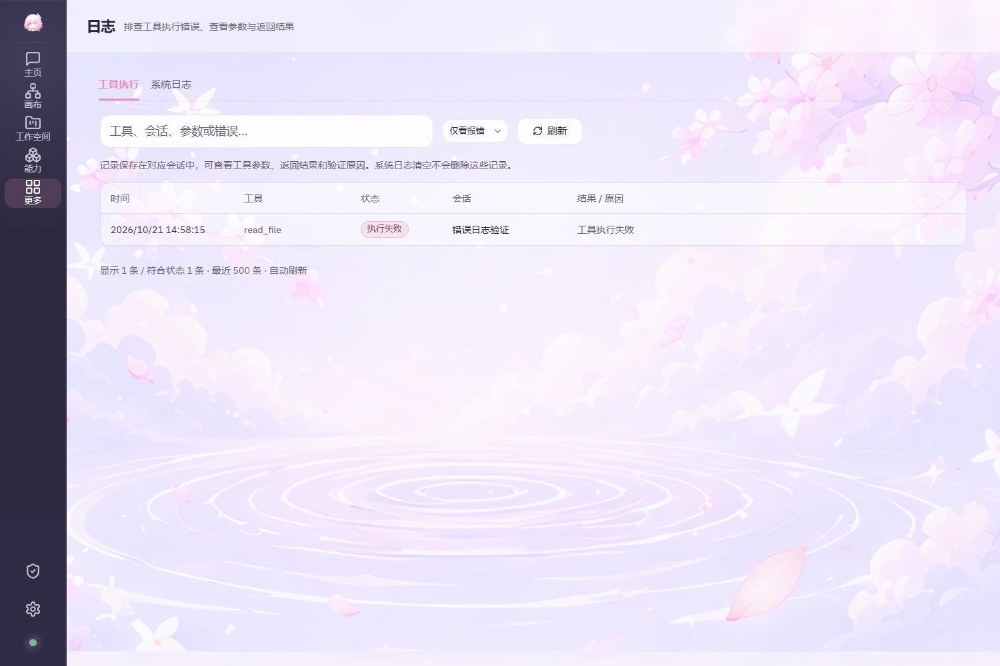
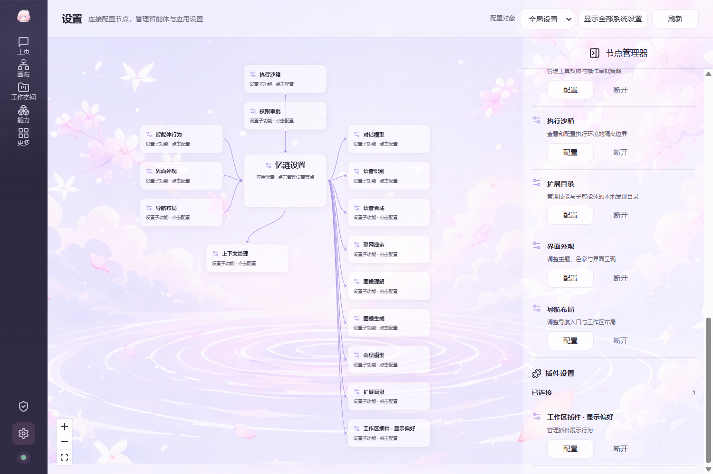
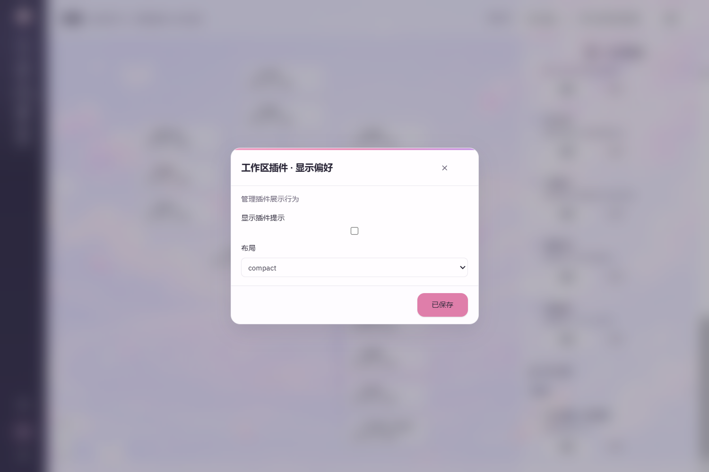
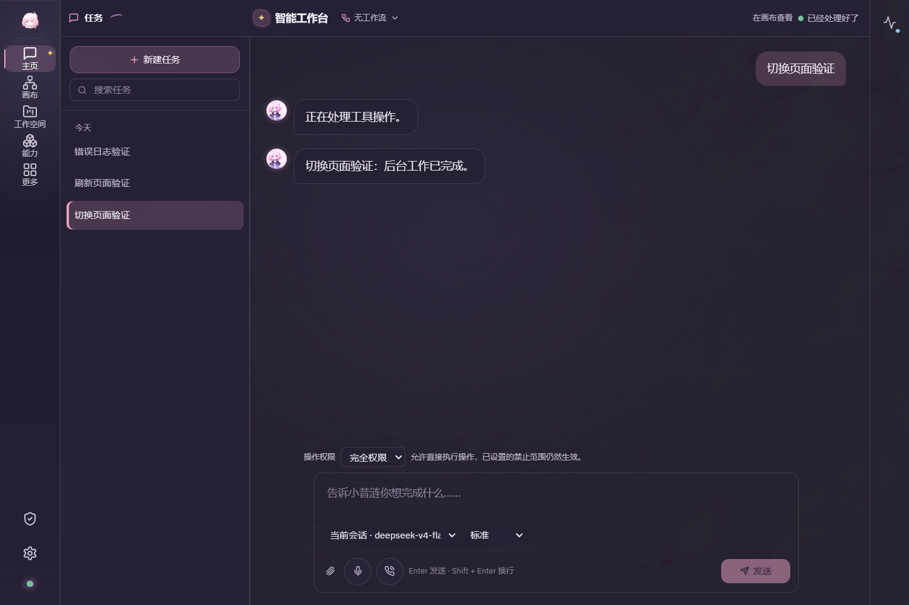

# 第4轮实际桌面预览

图片直接截取自独立Tauri桌面窗口，使用本项目当前原生源码和前端，源码副本通过SHA-256核对。未修改截图内容。窗口证据与执行验证见[本轮结果](../revision-4-results.md)。

## 主页与透明输入区

## 切换页面后恢复待审批操作

## 较窄外观弹窗与字号控制

## 移除分类切换的较窄能力弹窗

## 与主页连通的消息画布

## 工具报错与执行记录

## 系统与插件设置节点管理器

## 插件声明的实际设置表单

## 深色主题主页

