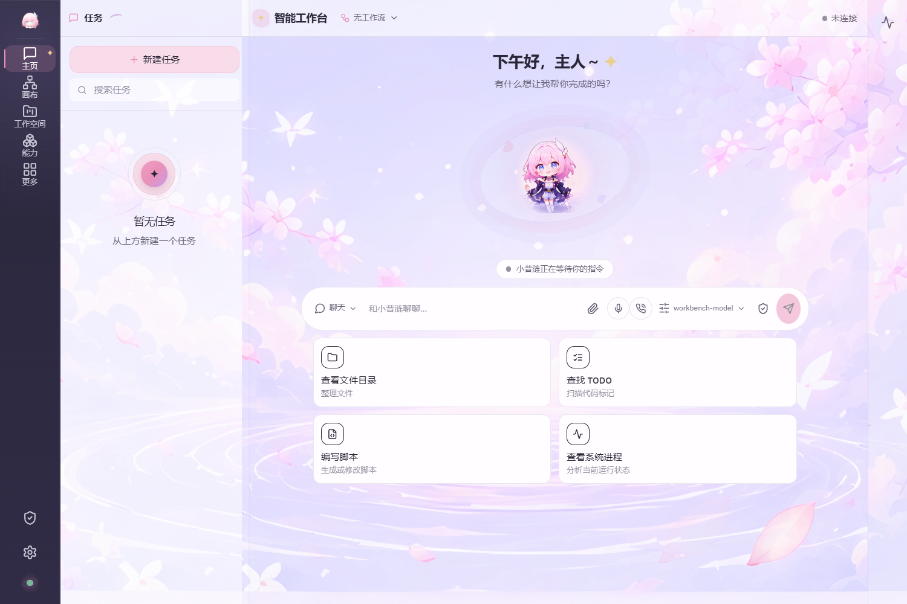
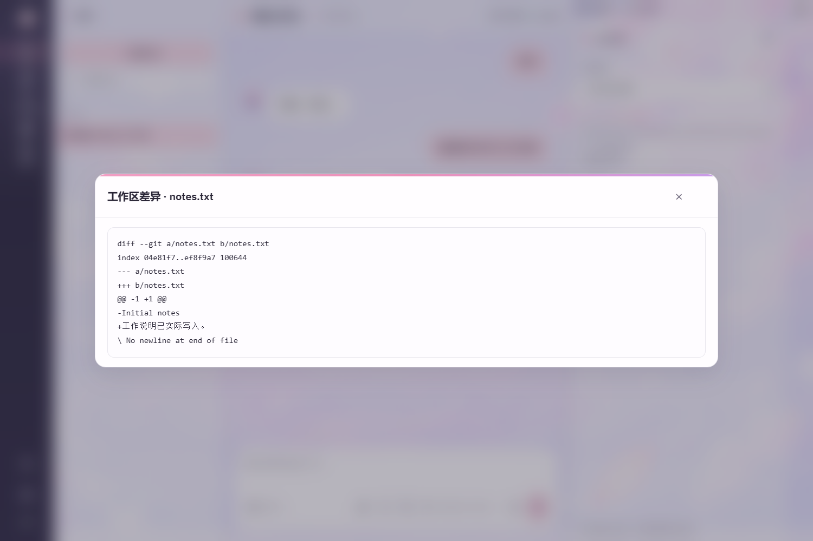
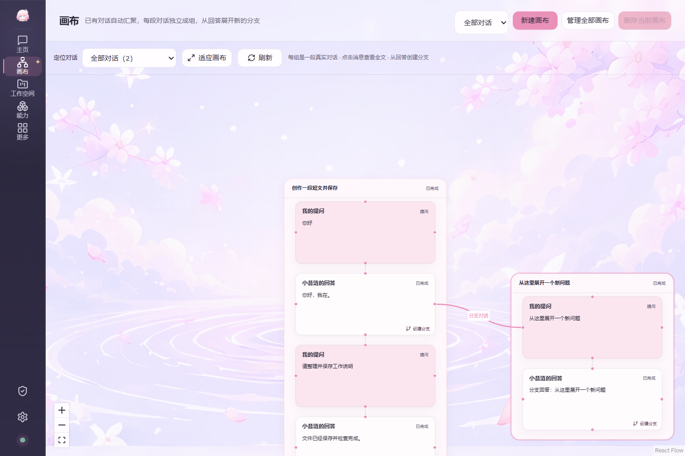
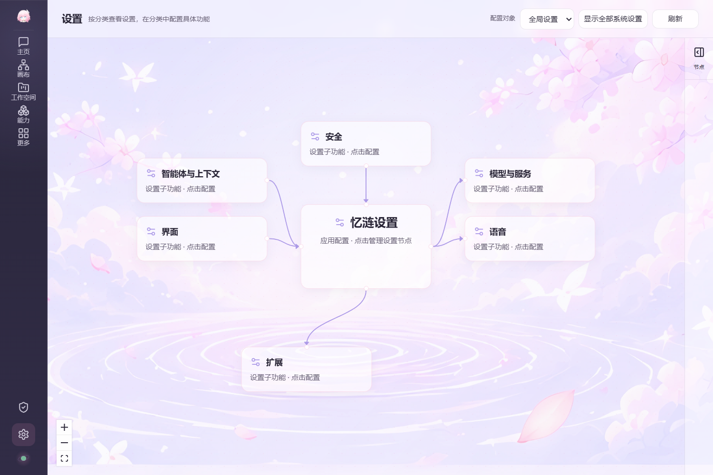
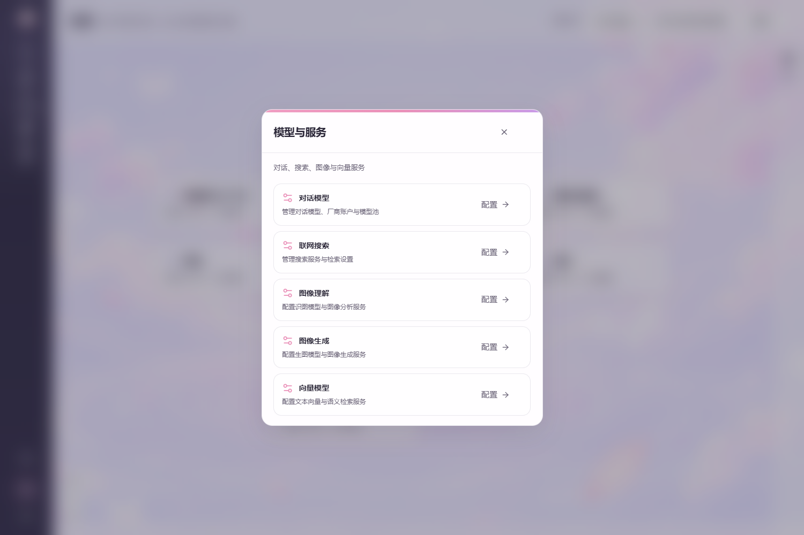
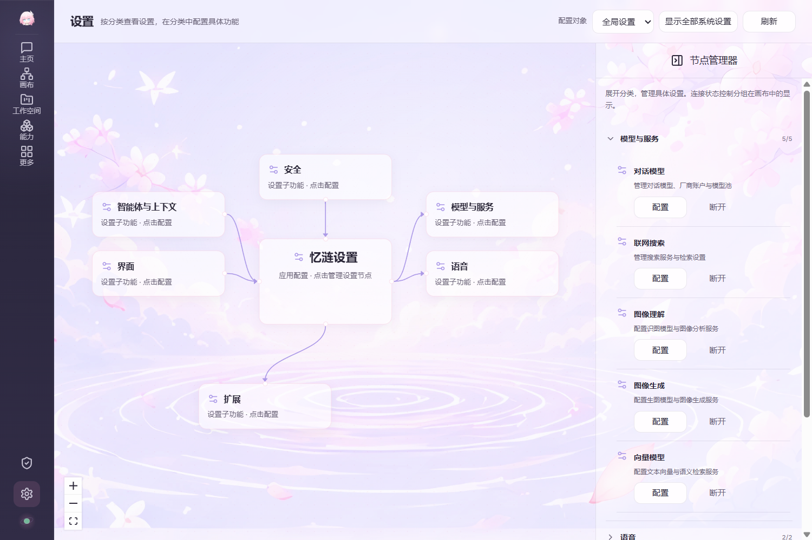

# 第5轮实际桌面预览

本组图片直接截取自独立Tauri桌面窗口，未修改截图内容。浮窗图片保留其实际64逻辑像素客户区；通话图片显示未配置语音服务时的真实异常状态。[开发与验证结果](../revision-5-results.md)。

## 单行聊天输入区

## 工作模式与Git变更

## 创造模式与实际文件

## 文件差异查看

## 真实对话分组与曲线分支

## 六组一级设置

## 紧凑二级设置

## 分组节点管理器

## 可拖动监控收起态

## 可拖动通话收起态

