# 2026-10-21 实际运行截图

浏览器界面取自1440×900的实际前后端运行。原生浮窗取自实际Tauri WebView2与窗口API；Windows缩放为125%。测试使用独立数据目录，不复制用户配置或密钥。

模型池测试的两级服务由本地HTTP测试服务返回503与有效SSE回复，实际经过产品API、运行时、持久化、用量和UI。通话截图记录未配置厂商凭据的错误路径；连续语音设备验收另列在实现报告。

**连接器：真实绑定与紧凑布局**

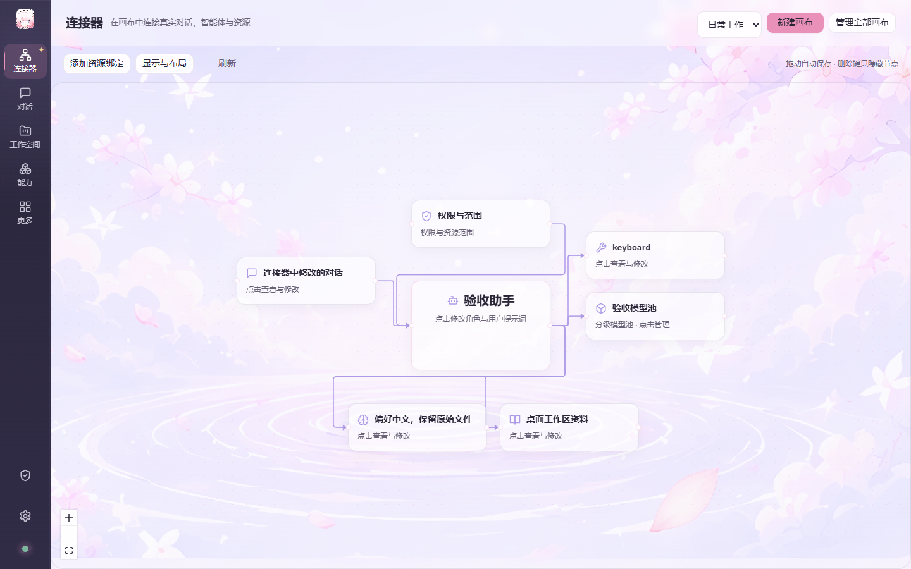

**能力：按行从左到右的导航**

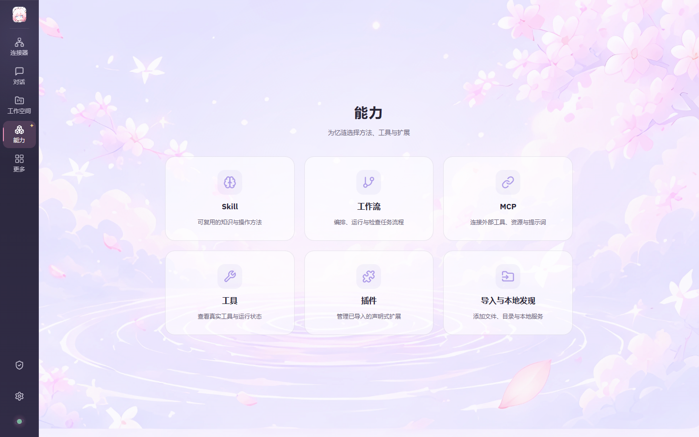

**更多：独立导航页**

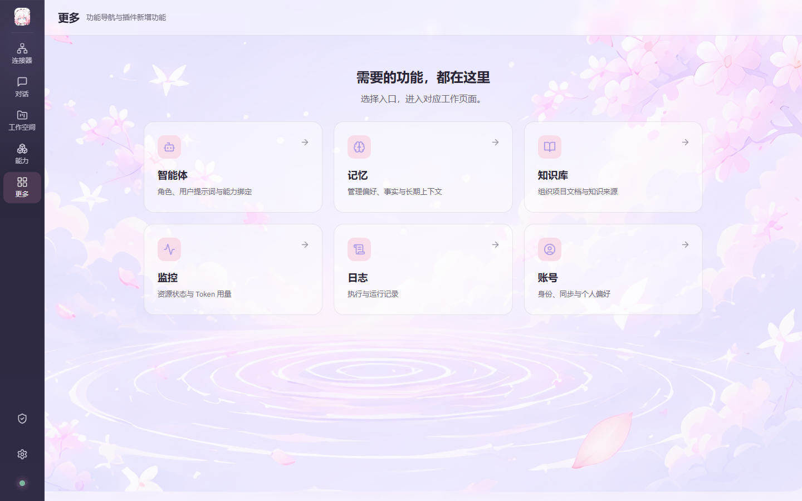

**模型池：两级候选与管理弹窗**

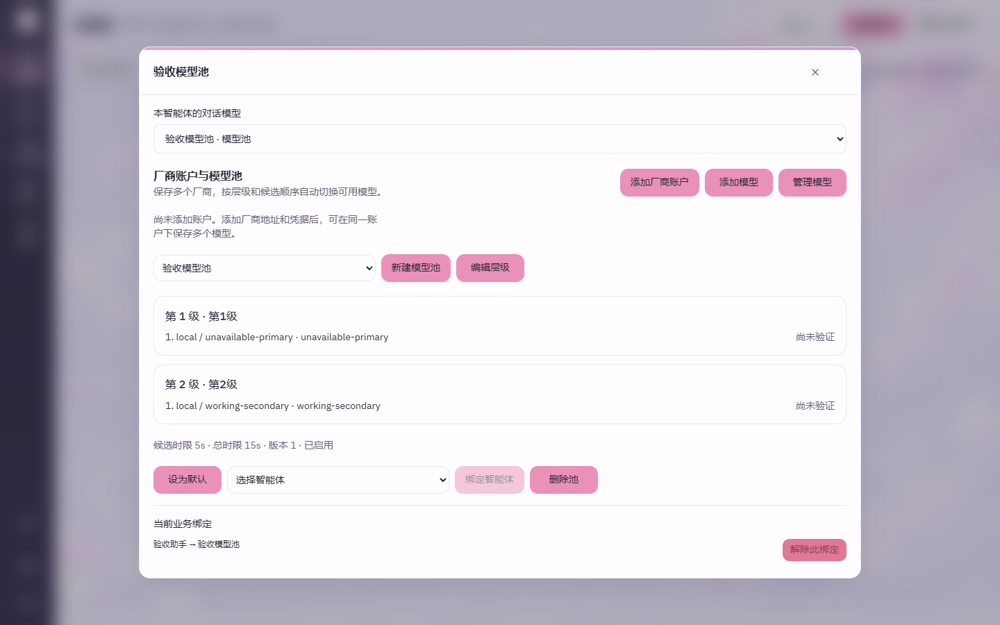

**降级：第一级503后使用第二级并保存回复**

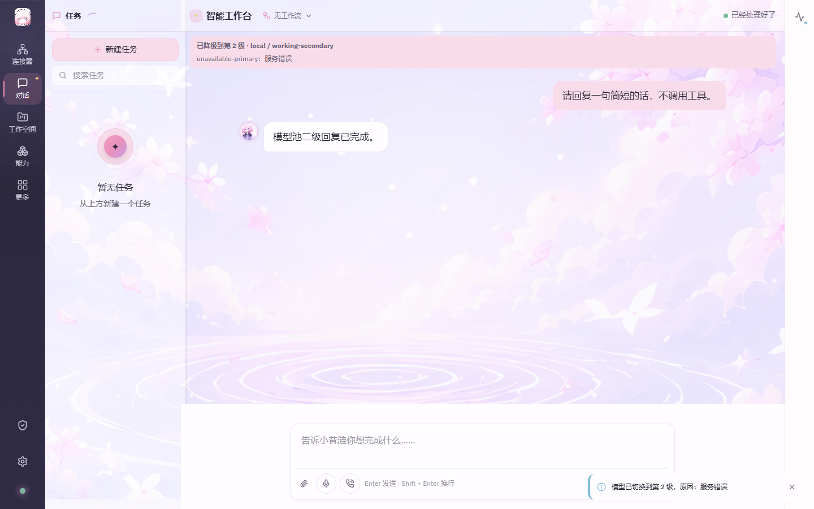

**权限：当前智能体的操作范围**

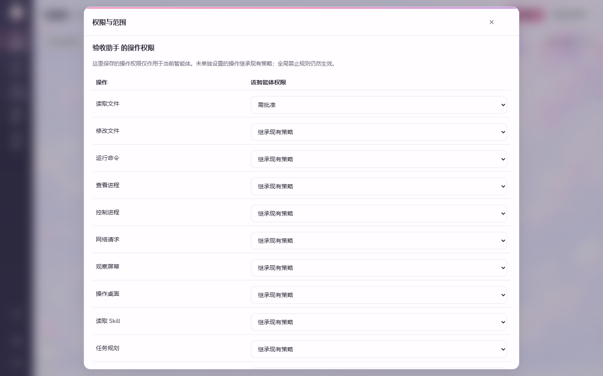

**监控：实际响应中的Token汇总**

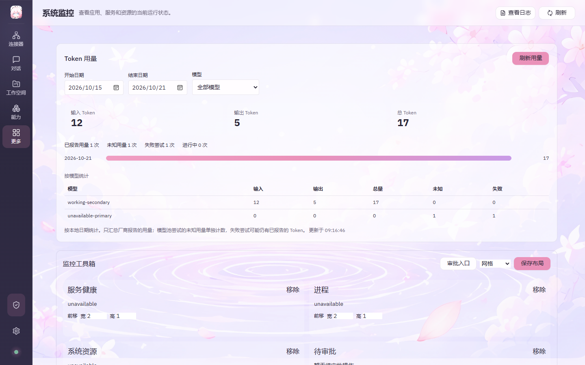

**原生监控独立浮窗**

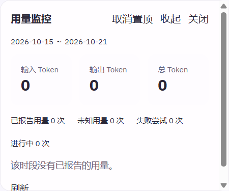

**原生通话：配置未接通时的错误反馈**

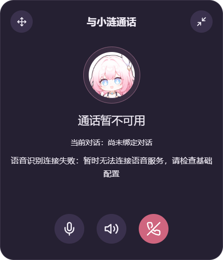

**原生通话：64px收起态**

**原生监控：64px收起态**

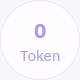

**能力管理弹窗**

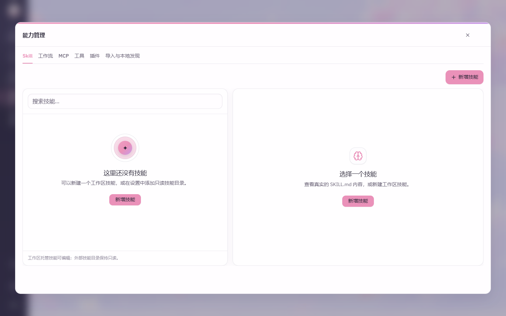

**基础配置中的模型管理弹窗**

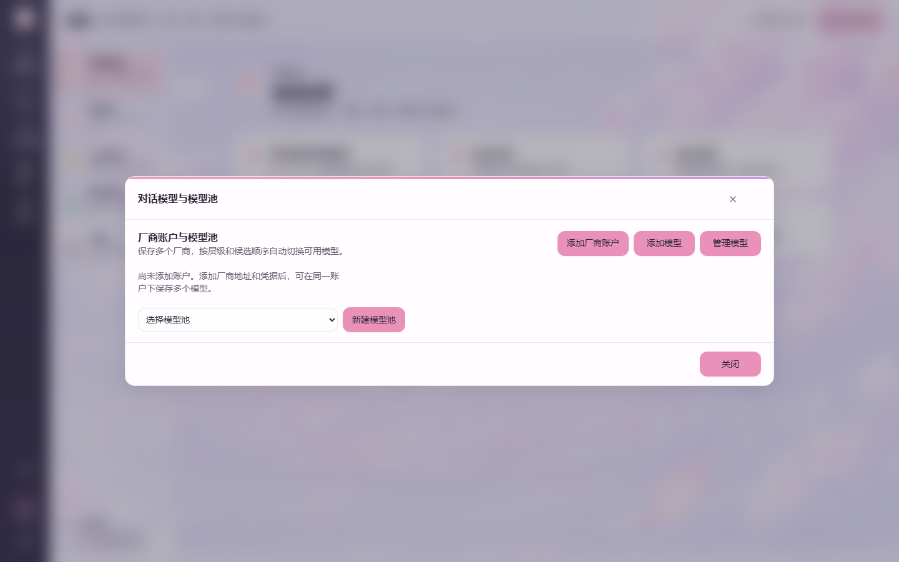

**删除最后一张画布后的空状态**

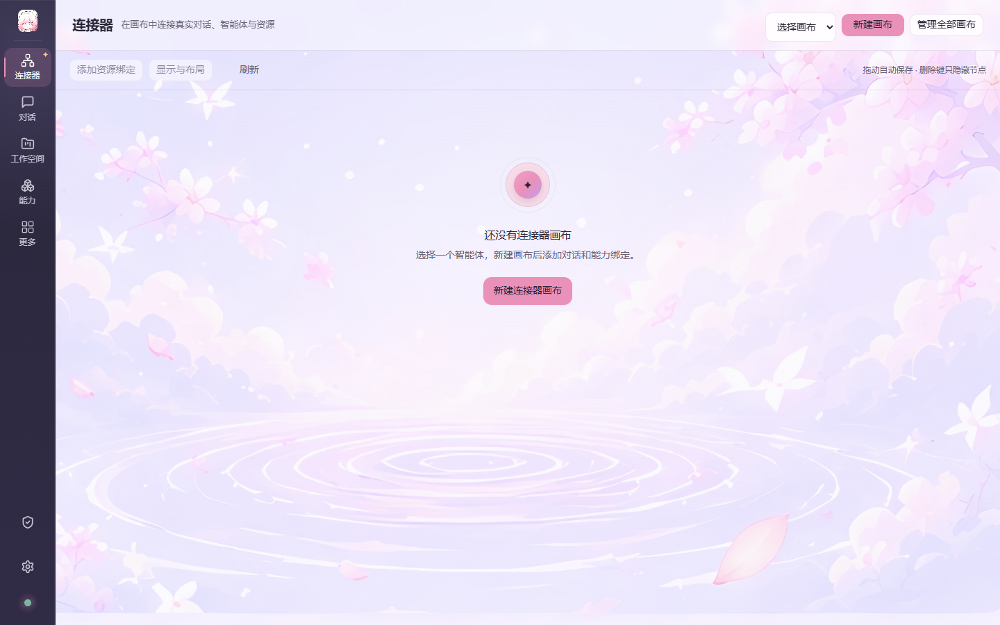

源文件与SHA-256记录见[截图清单](manifest.json)。
